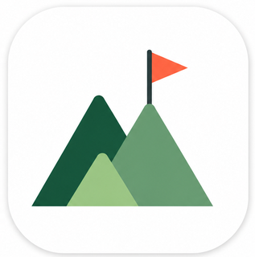
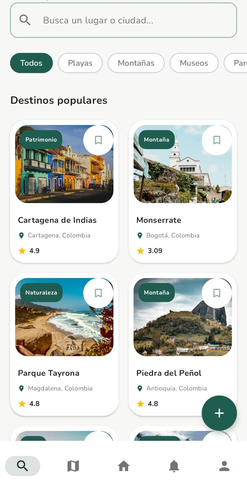
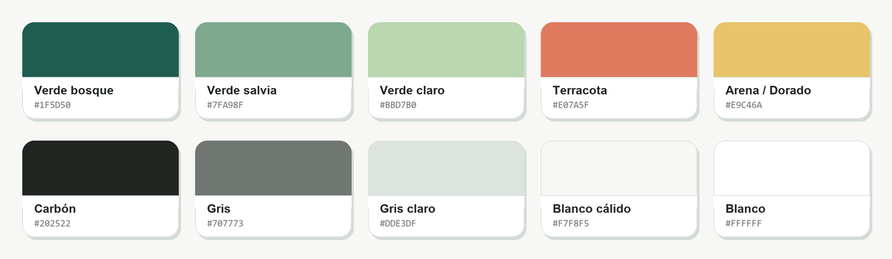

**Descubre lugares. Comparte experiencias. Encuentra tu próximo spot.**

[English](./README.md) | [Español](./README.es.md)

## Video promocional

https://github.com/user-attachments/assets/3c64ea2a-a61d-4401-9707-049da7fe5c72

---

## Sobre WaySpot

WaySpot es una aplicación Android diseñada para reunir a personas alrededor del descubrimiento de destinos turísticos y lugares especiales. Los usuarios pueden explorar lugares, compartir experiencias con reseñas y calificaciones, interactuar con las recomendaciones de la comunidad y seguir a otros viajeros.

### Nuestra propuesta de valor

WaySpot ayuda a los viajeros a descubrir, calificar y compartir lugares mediante reseñas auténticas de la comunidad. Estas experiencias ayudan a encontrar destinos, planear viajes con más información y conectar con otras personas que disfrutan explorar.

---

## Funcionalidades principales

- Explorar destinos turísticos y lugares especiales por categoría.
- Encontrar lugares en un mapa interactivo.
- Publicar reseñas, calificaciones y fotos.
- Interactuar con reseñas y seguir a otros usuarios.
- Guardar lugares para consultarlos después.
- Explorar el feed de la comunidad y recibir notificaciones de actividad.

---

## Mockups seleccionados

Estos mockups muestran la interfaz actual en español.

### Explorar y mapa

  
  
  

### Detalles de un lugar

  
  

---

## Tecnologías

- Kotlin y Android
- Jetpack Compose y Material 3
- Firebase Authentication, Firestore, Cloud Functions, Storage, Analytics, Cloud Messaging y Crashlytics
- MapLibre para mapas
- Retrofit para comunicación con API REST
- Hilt para inyección de dependencias
- Git, GitHub y Android Studio

---

## Descripción técnica: la capa `data`

El paquete `data` conecta la aplicación con sus servicios remotos y transforma sus respuestas en modelos que puede usar el resto de la app:

1. Un ViewModel solicita información a través de un repositorio, por ejemplo `PlaceRepository`.
2. El repositorio llama a una fuente de datos mediante una interfaz. Hilt conecta esas interfaces con sus implementaciones en `DataSourceModule`.
3. Las fuentes de datos leen o escriben en servicios remotos. Los lugares y los datos de usuarios/reseñas usan Cloud Firestore; las recomendaciones de lugares cercanos usan una función callable de Firebase. También hay servicios Retrofit para endpoints REST.
4. Los DTO representan las respuestas remotas y los mappers las convierten en modelos de la aplicación. Los repositorios devuelven valores `Result`, incluidos los errores, a la capa que los llamó.

El paquete se organiza en `datasource` (acceso a servicios), `dto` (formatos de intercambio), `mapper` (conversiones), `model` (datos de la app), `repository` (coordinación y manejo de errores) e `injection` (vinculaciones de Hilt). `data/local/PreviewData.kt` y `PreviewDataPopular.kt` contienen datos de muestra para las vistas previas; no son una base de datos local persistente.

---

## Identidad visual

La paleta de WaySpot combina verdes inspirados en la naturaleza, calidez y contraste para crear una identidad visual reconocible y cercana.

  

---

## Equipo del proyecto

| Integrante | Rol |
| --- | --- |
| Andrés Cortés | Technical Project Manager y Developer |
| Santiago Bautista Velásquez | Scrum Master y Developer |
| Iván Fuenmayor | Software Developer |
| Andrés Rodríguez Díaz | Software Developer |

