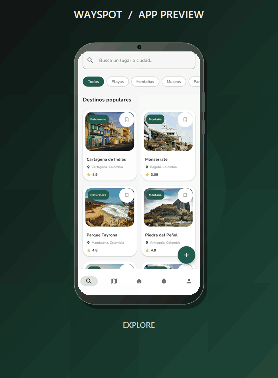

**Descubre lugares. Comparte experiencias. Encuentra tu próximo spot.**

## Video promocional

https://github.com/user-attachments/assets/51c5f168-5138-4f3f-b2d4-b18493d73697

---

## Sobre WaySpot

WaySpot es una aplicación Android diseñada para reunir a personas alrededor del descubrimiento de destinos turísticos y lugares especiales. Los usuarios pueden explorar lugares, compartir experiencias con reseñas y calificaciones, interactuar con las recomendaciones de la comunidad y seguir a otros viajeros.

### Nuestra propuesta de valor

WaySpot ayuda a los viajeros a descubrir, calificar y compartir lugares mediante reseñas auténticas de la comunidad. Estas experiencias ayudan a encontrar destinos, planear viajes con más información y conectar con otras personas que disfrutan explorar.

---

## Funcionalidades principales

- Explorar destinos turísticos y lugares especiales por categoría.
- Encontrar lugares en un mapa interactivo.
- Publicar reseñas, calificaciones y fotos.
- Interactuar con reseñas y seguir a otros usuarios.
- Guardar lugares para consultarlos después.
- Explorar el feed de la comunidad y recibir notificaciones de actividad.

---

## Mockups de la app en movimiento

La vista animada recorre las pantallas de explorar, mapa y detalles dentro de un marco de celular de WaySpot.

  

---

## Tecnologías

- Kotlin y Android
- Jetpack Compose y Material 3
- Firebase Authentication, Firestore, Cloud Functions, Storage, Analytics, Cloud Messaging y Crashlytics
- MapLibre para mapas
- Retrofit para comunicación con API REST
- Hilt para inyección de dependencias
- Git, GitHub y Android Studio

---

## Descripción técnica: la capa `data`

El paquete `data` conecta los ViewModels con Firebase y los servicios REST; así, el acceso remoto y la conversión de respuestas quedan fuera de la capa visual.

### Recorrido de una solicitud de lugares

1. Un ViewModel solicita lugares o un lugar por ID a `PlaceRepository`.
2. Hilt proporciona el repositorio mediante su constructor `@Inject` y resuelve su dependencia `PlaceRemoteDataSource`.
3. `DataSourceModule` vincula `PlaceRemoteDataSource` con `PlaceFirestoreDataSourceImplementation`. Hilt inyecta `FirebaseFirestore` en esa implementación, que consulta la colección `places`; `await()` integra las tareas de Firebase con las corrutinas.
4. Los documentos de Firestore se convierten en DTO. El repositorio los mapea a modelos de la app, como `PlaceInfo`, y devuelve un `Result` de Kotlin a quien hizo la solicitud.

### Cómo se configura la inyección de dependencias

- `FirebaseHiltModule` se instala en el `SingletonComponent` de Hilt. Sus métodos `@Provides` entregan Firebase Authentication, Storage, Firestore y Functions; Firestore y Functions están marcados como singletons.
- `AppModule` proporciona una instancia singleton de Retrofit y las interfaces de servicios REST para lugares, reseñas y usuarios.
- `DataSourceModule` usa `@Binds` para relacionar las interfaces de fuentes de datos con sus implementaciones concretas: por ejemplo, lugares, reseñas y usuarios respaldados por Firestore, y la fuente callable para lugares cercanos.
- Los repositorios reciben esas interfaces en constructores `@Inject`. Hilt arma el grafo de dependencias, de modo que los ViewModels dependen de repositorios sin construir objetos de Firebase o Retrofit.

La búsqueda de lugares cercanos sigue el mismo patrón: `NearbyPlacesRepository` llama a la fuente callable, convierte cada respuesta en `NearbyPlace` y devuelve un `Result`. Los repositorios representan las excepciones normales como fallos y vuelven a lanzar la cancelación de corrutinas para conservar su comportamiento.

El paquete se organiza en `datasource` (acceso remoto), `dto` (respuestas de servicios), `mapper` (conversiones), `model` (datos de la app), `repository` (coordinación y manejo de errores) e `injection` (proveedores y vinculaciones de Hilt). `data/local/PreviewData.kt` y `PreviewDataPopular.kt` contienen datos de muestra solo para vistas previas; no son una base de datos local persistente.

---

## Identidad visual

La paleta de WaySpot combina verdes inspirados en la naturaleza, calidez y contraste para crear una identidad visual reconocible y cercana.

  

---

## Equipo del proyecto

| Integrante | Rol |
| --- | --- |
| Andrés Cortés | Technical Project Manager y Developer |
| Santiago Bautista Velásquez | Scrum Master y Developer |
| Iván Fuenmayor | Software Developer |
| Andrés Rodríguez Díaz | Software Developer |

