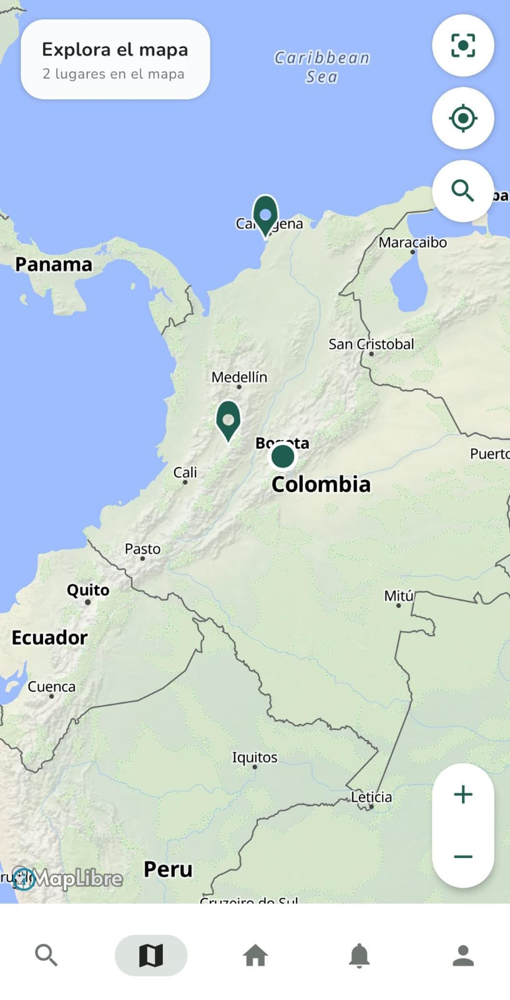
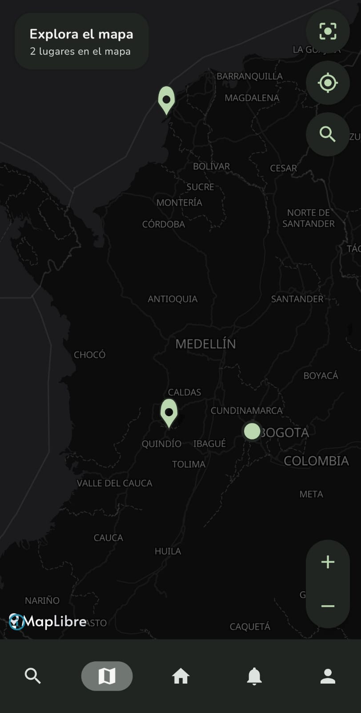
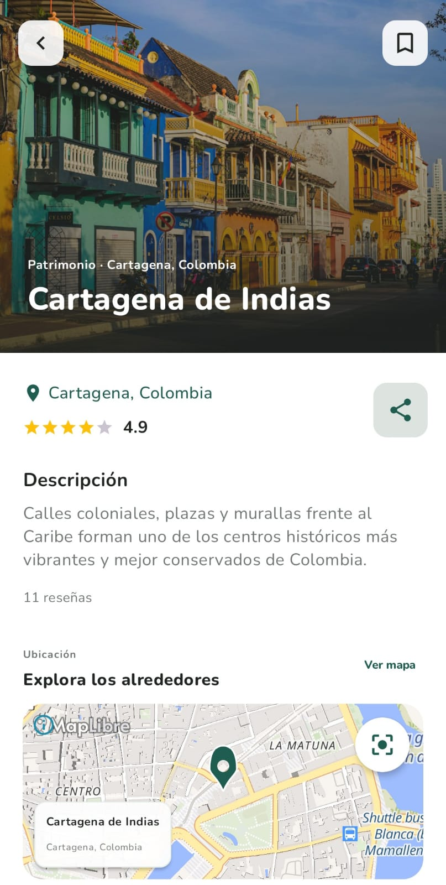
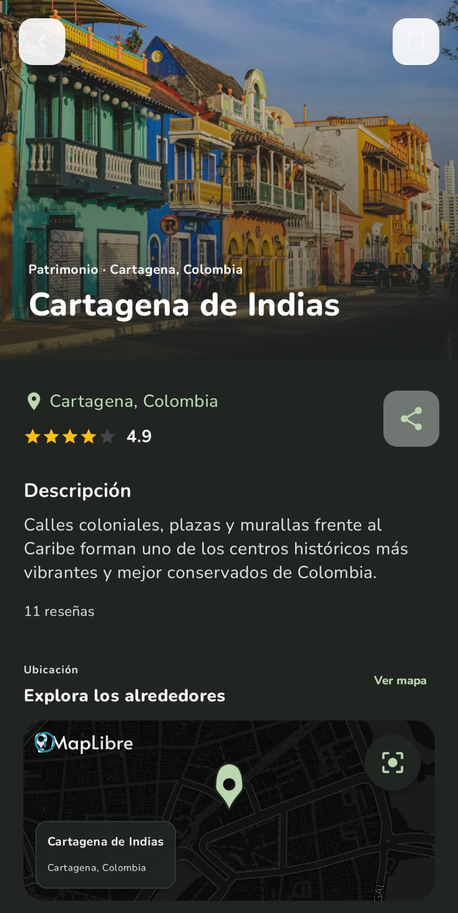

**Descubre lugares. Comparte experiencias. Encuentra tu próximo spot.**

[English](./README.md) | [Español](./README.es.md)

  
   
  Selecciona la imagen para abrir el video promocional de 60 segundos en español.

## Sobre WaySpot

WaySpot es una aplicación Android diseñada para reunir a personas alrededor del descubrimiento de destinos turísticos y lugares especiales. Los usuarios pueden explorar lugares, compartir experiencias con reseñas y calificaciones, interactuar con las recomendaciones de la comunidad y seguir a otros viajeros.

### Nuestra propuesta de valor

WaySpot ayuda a los viajeros a descubrir, calificar y compartir lugares mediante reseñas auténticas de la comunidad. Estas experiencias ayudan a encontrar destinos, planear viajes con más información y conectar con otras personas que disfrutan explorar.

## Funcionalidades principales

- Explorar destinos turísticos y lugares especiales por categoría.
- Encontrar lugares en un mapa interactivo.
- Publicar reseñas, calificaciones y fotos.
- Interactuar con reseñas y seguir a otros usuarios.
- Guardar lugares para consultarlos después.
- Explorar el feed de la comunidad y recibir notificaciones de actividad.

## Mockups seleccionados

Estos mockups muestran la interfaz actual en español.

### Explorar y mapa

  
  
  

### Detalles de un lugar

  
  

## Tecnologías

- Kotlin y Android
- Jetpack Compose y Material 3
- Firebase Authentication, Firestore, Cloud Functions, Storage, Analytics, Cloud Messaging y Crashlytics
- MapLibre para mapas
- Retrofit para comunicación con API REST
- Hilt para inyección de dependencias
- Git, GitHub y Android Studio

## Identidad visual

La paleta de WaySpot combina verdes inspirados en la naturaleza, calidez y contraste para crear una identidad visual reconocible y cercana.

  

## Diseño en Figma

Los mockups y el diseño de interacción están disponibles en el [archivo de WaySpot en Figma](https://www.figma.com/make/RBOjIUcUe0htgqXmQTybX8/ReviewHub-mobile-app-design?code-node-id=0-6&p=f&t=n2XtAjCNciJ0qnT3-0&fullscreen=1).

## Equipo del proyecto

| Integrante | Rol |
| --- | --- |
| Andrés Cortés | Technical Project Manager y Developer |
| Santiago Bautista Velásquez | Scrum Master y Developer |
| Iván Fuenmayor | Software Developer |
| Andrés Rodríguez Díaz | Software Developer |
